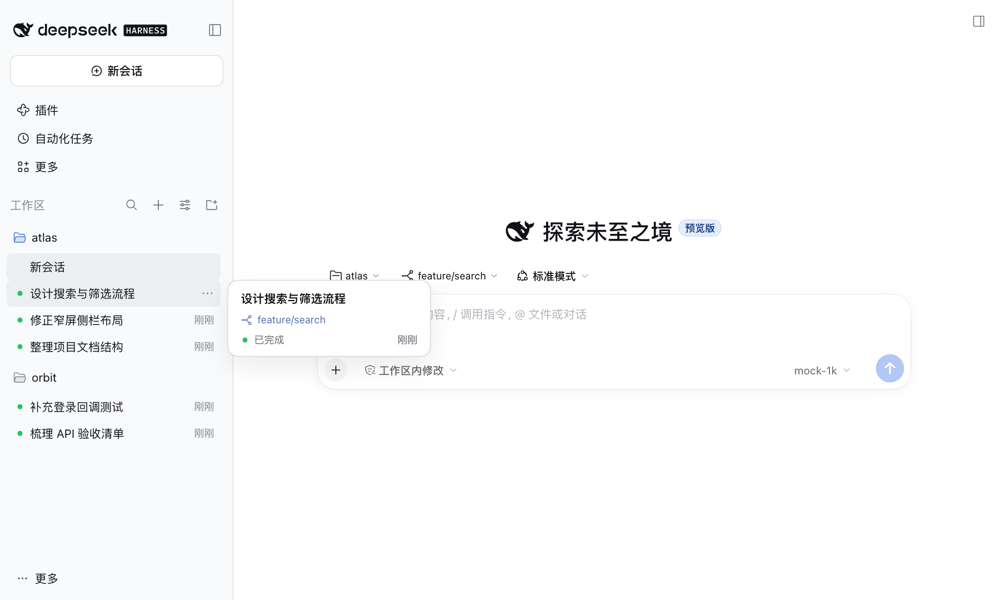
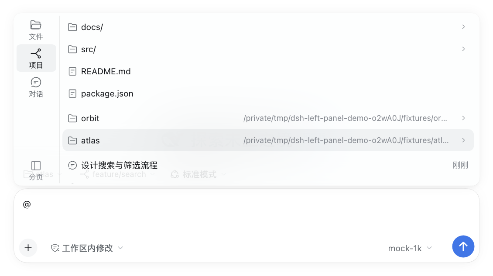

# dsh-left-panel

为 DeepSeek Harness（DSH）添加基于 Git 工作树的项目侧栏。添加任一工作树后，插件会自动发现同仓库的其他工作树，让你按项目浏览会话、在指定分支上开启对话，以及在输入框里引用项目目录。



## 安装

需要在 DSH 宿主上安装 Git。包声明支持 DSH `>=0.2.2-rc.1 <0.3.0`。项目引用和 `@` 面板导航依赖 DSH 的输入触发服务，已在 `0.2.2-rc.5` 上验证。

### npm 发布版

按实际使用的 profile 运行其中一条命令。

```sh
# DSH Desktop
dsh plugin --profile desktop add dsh-left-panel

# DSH Web
dsh plugin --profile web add dsh-left-panel
```

macOS 上可以直接使用 Desktop 自带的命令。

```sh
"/Applications/DeepSeek Harness.app/Contents/Resources/runtime/cli/bin/dsh" \
  plugin --profile desktop add dsh-left-panel
```

安装后重启对应的 DSH 实例。Web 用户再刷新浏览器页面。

### 从当前仓库安装

下文的功能说明以当前仓库为准。要体验源码中的更新，在仓库根目录使用 Node.js 24 和 pnpm 12 构建，然后安装到对应的 profile。这与发布流程使用的环境一致。

```sh
pnpm install --frozen-lockfile
pnpm build
dsh plugin --profile desktop add "file:$PWD" --ignore-scripts
```

## 使用

### 添加项目并浏览会话

1. 在侧栏点 **添加工作区**，选择仓库根目录或其中一棵工作树的根目录。没有原生目录选择器时，可在侧栏输入宿主上的绝对路径。插件会把同一仓库的工作树归到一个项目下。普通目录仍显示为独立工作区。
2. 在 **视图选项 → 分组方式** 里选择浏览方式。

   | 视图 | 内容 |
   | --- | --- |
   | **按工作区** | 项目 → 工作树 → 会话，适合查看或管理各个分支。 |
   | **按项目** | 项目下直接列出各工作树的会话，悬停会话可查看它所属的分支。 |
   | **单列表** | 将会话合并到一张列表中。 |

3. 用 **新建分区** 整理项目。分区可以折叠或拖动，项目可以在分区之间拖动。**项目排序方式**默认手动排序，也可切换为 **最近更新**。这时每个分区内最近有会话更新的项目排在前面，项目内的工作树仍可手动排序。

侧栏的会话列表按最近更新时间倒序排列。你可以搜索会话标题和正文，也可以在顶部显示运行中、待处理和完成未读的活跃会话。设有活跃提醒的会话会显示时钟图标。会话菜单提供重命名和归档，已开始的会话还可以分叉。会话正文搜索由 DSH 提供，服务不可用时仍可按标题查找。

### 新建会话

- **从侧栏进入**。悬停项目行，点省略号左边的 **+**，在主工作树当前检出的分支上新建会话。在 **按工作区** 视图中，也可以点某棵工作树行上的 **+** 来指定分支。
- **在新会话页选择**。先选项目，插件会默认选中主工作树，并在旁边显示独立的分支选择器。分支菜单只列出已签出且已注册为工作区的分支，并显示实际 Git 分支名。主工作树不可选时，默认选中第一个可用分支。普通工作区可直接选择。

会话的工作目录是选中工作树的目录。主工作树当前检出的分支可以是 `main`，也可以是其他分支。

### 在输入框中引用项目

输入 `@` 可打开引用面板。左侧的 **文件 → 项目 → 对话** 默认跳转到同一列表里的对应区块，左下角可以切换到分页模式。候选项在面板内部滚动。



- 点项目名，发送时传递该项目主工作树的绝对路径。
- 点项目右侧的箭头进入工作树列表，再选具体工作树，发送时传递那棵工作树的绝对路径。

路径以引用的方式插入消息。会话仍在新建时选定的工作区中运行。

## 工作树管理与数据

| 操作 | 效果 |
| --- | --- |
| **新建 worktree** | 在项目菜单中创建分支，或检出尚未签出的本地分支。新分支默认基于主工作树的 `HEAD`，工作树目录可以修改。 |
| **重命名** | 项目名用于侧栏展示。工作树菜单分别提供 **重命名显示名称** 和 **重命名分支名称**，可单独修改 DSH 工作区标题或 Git 分支名。 |
| **复制绝对路径** | 从工作树菜单复制该工作树的完整目录。 |
| **移除工作区／项目** | 移除 DSH 注册记录，保留目录、Git 分支和会话日志。单独移除工作区时，主工作树受保护。**移除项目**会注销项目名下的全部工作区。 |
| **恢复工作区** | 从项目菜单的 **已移除的工作区** 恢复，或通过 **添加工作区** 重新选择该目录。插件会尝试按原工作目录重新关联已有会话。 |
| **同时删除分支** | 移除非主工作树时，可显式勾选此项来删除工作树目录和 Git 分支。如果检测到未提交改动或未合并提交，继续操作需要再次确认。 |

插件在启动、工作区变更和 Git 文件变化时进行同步，并用每 30 秒的轮询兜底。检测到附加工作树消失后，插件会等待 5 秒再复查，确认仍不可用时注销工作区记录。项目菜单中的 **刷新** 可以立即重扫。手动移除的工作区会记住其移除状态，直到从菜单恢复或重新添加目录。

会话仍由 DSH 管理。重新注册工作树后，插件会用 DSH 的工作目录校验重新关联已有会话。会话 ID、日志和工作目录都会保留。卸载后，已注册的工作区及其排列顺序也会保留。项目名称和移除记录保存在 `$DSH_HOME/storages/dsh-left-panel.json`，默认 `DSH_HOME` 为 `~/.dsh`。分区、折叠和布局偏好保存在客户端。

卸载时，选择原来安装所用的 profile 并重启 DSH。

```sh
dsh plugin --profile desktop remove dsh-left-panel
```

## 开发与演示

```sh
pnpm install --frozen-lockfile
pnpm typecheck
pnpm build
pnpm test
pnpm demo
```

`pnpm demo` 会在临时 `DSH_HOME` 下启动真实 DSH，准备两个示例仓库和五棵工作树，并接入本地模拟模型。终端会输出浏览器访问地址，按 `Ctrl+C` 即可停止演示并清理临时数据。可用 `DSH_BIN` 指定 DSH CLI，或用 `DEMO_PORT` 和 `DEMO_MOCK_PORT` 指定端口。

| 位置 | 职责 |
| --- | --- |
| `src/service.ts`、`src/sync.ts` | 扫描 Git 工作树，同步 DSH 注册记录，处理项目和分支操作。 |
| `src/client/` | 侧栏、新会话选择器和 `@` 引用面板，复用 DSH 的工作区和会话服务。 |
| `src/protocol.ts` | 定义客户端和宿主通过 DSH `/api` 通道交换的工作树快照。 |
| `test/` | 验证实际 Git 工作树同步、会话分组、分支选择和引用路径等行为。 |

## 许可证

本项目使用 MIT 许可证。侧栏部分代码派生自 DeepSeek 的 `@deepseek-ai/dsh-client-ui-workspace`，相关文件保留原始版权声明。详见 [LICENSE](LICENSE)。
